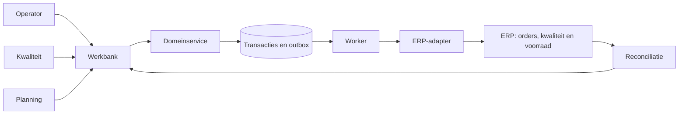

# Oplossingsarchitectuur en standaard-eerst besluit

Voor business, ERP-consultant en technische lead. Dit document onderscheidt de werkende browserdemo van het doelontwerp dat eerst op een ERP-fit-gap moet worden getoetst.

[Bekijk het architectuurdiagram](../diagrams/architecture.svg).

## Business- en systeemcontext
Kwaliteit beslist over conformiteit. Planning beslist over capaciteit. Sales beslist over een gewijzigde klantbelofte. ERP beheert administratieve orders en voorraad. De workbench verbindt het signaal, de afweging en het bevestigingsspoor.

## Prototype versus doel
| Laag | Hier werkend | Productievoorwaarde |
|---|---|---|
| Presentatie | Statische HTML/CSS, ES-modules en lokale UI-state | Enterprise identity, route-/sessiebeveiliging |
| Domein | Zuivere functies, rollencheck, versiecheck, invarianten | Servertransactie, concurrencycontrole en authoritative reads |
| Opslag | localStorage per browser | Relationele DB, back-up en retentie |
| Integratie | Outbox en apart ontvangstregister in dezelfde browser | Duurzame worker, netwerk, ERP-sandbox en reconciliatietaak |
| Audit | Herleidbare sequence en versie, lokaal wijzigbaar | Append-only opslag met actor-ID, timestamp en correlation-ID |

Geen framework is nodig voor dit statische analistenportfolio. Domeinregels zitten apart van rendering. Het eigen ERP-contract is een facadeontwerp, geen nagebootste officiële SAP-endpoint. Waar standaard ERP-schermen en kwaliteitsprocessen volstaan, heeft configuratie voorrang boven een nieuwe applicatie.

## Eerste technische spike
ERP-consultant toont een echte inspectie met gedeeltelijke bestemming. Analist volgt één order, keuringsresultaat, gebruiksbesluit en boekingsdocument. Team bewijst daarna een dubbel bericht, een verloren bevestiging en een oudere versie in sandbox. Zonder die spike geen besluit om de workbench te bouwen.

## Drie doorslaggevende keuzes
[ADR-01: functiescheiding](../adr/01-quality-ownership.md); [ADR-03: verklaarbare capaciteit](../adr/03-planning.md); [ADR-04: versiegebonden overdracht](../adr/04-erp-delivery.md). Implementatie blijft één service met relationele opslag; geen microservices of machinekoppeling nodig voor de gekozen scope.

Vorige: [Proces](../03-processes/process-design.md). Volgende: [Data](data-model.md).
