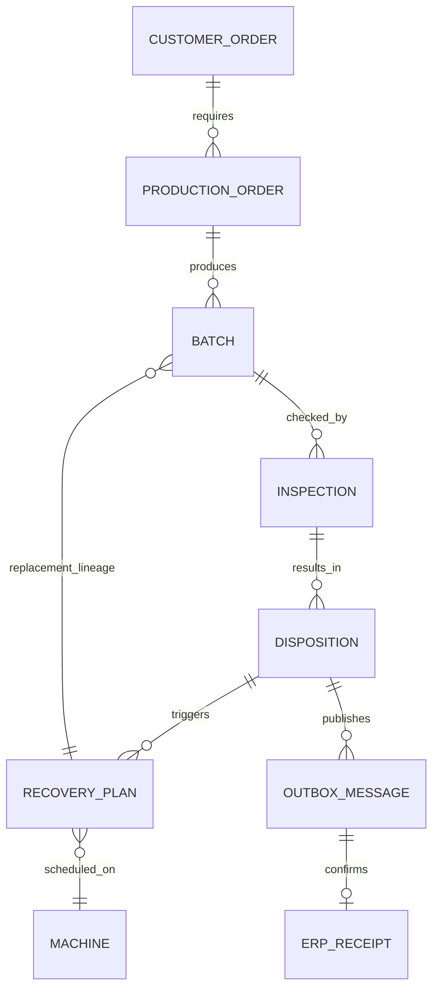

# Datamodel, hoeveelheden en eigenaarschap

Voor analist, data-eigenaar en developer. Dit is een logisch doelmodel; de browser gebruikt een kleinere dossierprojectie. Het aggregaat is nooit een vervanging van fysieke ERP-partijtraceerbaarheid.

| Entiteit | Sleutel / minimale velden | System of record / eigenaar |
|---|---|---|
| CustomerOrder | orderId, product, hoeveelheid, levermoment, site | ERP / Sales |
| ProductionOrder | productionOrderId, orderId, lijn, status, planversie | ERP/MES te bevestigen / Production owner |
| Batch | batchId, parentBatchId, productId, eenheid, hoeveelheid | ERP / Inventory owner |
| Inspection | inspectionId, batchId, meetresultaat, normversie | ERP QM of QMS te bevestigen / Quality lead |
| Disposition | decisionId, inspectie, verdeling, reden, bevoegd actor | ERP QM in doelvoorkeur / Quality lead |
| RecoveryPlan | planId, sourceDecisionId, versie, slot, hoeveelheid, keuze | Standaard planning waar passend / Planner |
| Machine | machineId, geschikte profielen, kalender, omstel, tempo | ERP/MES masterdata / Production engineering |
| Message/Receipt | id, sleutel, schema, payloadhash, correlatie, poging, status | Integratieservice / IT Operations |

## Hoeveelheidvoorbeeld
Start: 100 = 60 vrij + 40 in controle. Besluit: 100 = 70 vrij + 20 herwerk + 10 afkeur. Herwerkstrategie produceert 10 m² vervanging en herwerkt 20 m²: na gereedmelding is de dossierbalans 110 = 70 vrij + 10 controle + 20 herwerk + 10 afkeur. Na herkeuring: 110 = 100 vrij + 0 controle + 0 herwerk + 10 afkeur.

De 10 m² nieuwe productie krijgt een kindpartij, bijvoorbeeld B-2401-RP-1. In de demo telt het batch-object de hoeveelheden van dit dossier op. De kindpartij wordt apart geregistreerd; het aggregaat dient alleen voor impact en balans. In productie zijn voorraadboekingen per fysieke partij en inspectielot nodig, met eventueel meerdere verpakkingseenheden. Het prototype kan geen materiaalcertificaat of volledige genealogie bewijzen.

Volledige vervanging kan 30 m² nieuw maken en 20 m² herwerk laten bestaan. Die resthoeveelheid is geen verdwenen voorraad en mag niet impliciet worden afgekeurd. Een volgende workflow moet dit afzonderlijk behandelen; de MVP laat die open status eerlijk zien.

## Mapping en validatie
Geen materiaal-ID op basis van productnaam opzoeken; stabiele sleutels en sitetoewijzing zijn vereist. Eenheid, tijdzone, productversie en routing moeten overeenstemmen. Voor decimalen: integer base units gebruiken en afronding vóór boeking vastleggen. De demo kiest bewust gehele m² en één locatie. Ontbrekende geschiktheid betekent geen voorstel. Audit toont versies; een productieplatform voegt UTC-timestamps en betrouwbare actoridentiteit toe.

Vorige: [Architectuur](architecture.md). Volgende: [Planning](planning.md).
